 

## `01` / whoami

I'm **Vedansh**, a game developer, 3D artist and the founder of **[NoteX Studios](https://www.notexstudios.in)**, based in India. I turn ideas into playable worlds, from the systems underneath to the atmosphere you feel on screen.

My work lives where **code, art and a little obsession** meet. Horror, multiplayer chaos, environments with character. That's my kind of build.

- **Shipped:** Phantom Echoes Chapter I, available on Steam.
- **Building:** The Last Peg, a five-player multiplayer game.
- **At NoteX:** Game development, custom 3D assets and creative collaboration.

## `02` / selected builds

<table>
<tr>
<td width="50%" valign="top">

### 01 · PHANTOM ECHOES
**CHAPTER I · RELEASED ON STEAM**

A first-person psychological horror game set inside a distorted hotel. Environmental puzzles, hostile entities and a reality that refuses to stay still.

`Unity` `HDRP` `Horror` `PC`

**[Enter the hotel →](https://store.steampowered.com/app/4607190/Phantom_Echoes_Chapter_I/)**

</td>
<td width="50%" valign="top">

### 02 · THE LAST PEG
**FIVE PLAYERS · IN DEVELOPMENT**

Five players. One table. One poisonous glass. Read your opponents, make your move and survive a party built on deception and bad decisions.

`Unity 6` `URP` `Netcode` `Multiplayer`

**[Explore the project →](https://www.notexstudios.in/)**

</td>
</tr>
</table>

## `03` / equipped

**The daily loadout**

| Game systems | Visual craft | Connected worlds |
| :--- | :--- | :--- |
| C# gameplay programming | 3D modeling & environment art | Netcode for GameObjects |
| Unity 6 · URP · HDRP | Lighting, materials & atmosphere | Relay · Authentication · Cloud Save |

<b>Expand the rest of the toolkit</b>

 

Python · PowerShell · HTML · .NET · Node.js · Figma · Canva · WordPress

**Exploring:** advanced Unity workflows and Unreal Engine.

## `04` / open a connection

Have a game idea, need a custom asset, or want to build with NoteX? Let's talk.

**[esco.bar.001@gmail.com](mailto:esco.bar.001@gmail.com)**

[Studio](https://www.notexstudios.in) &nbsp; / &nbsp; [LinkedIn](https://www.linkedin.com/in/vedansh-yadav-248703375/) &nbsp; / &nbsp; [Instagram](https://www.instagram.com/not_ved4nsh/) &nbsp; / &nbsp; [Discord](https://discord.gg/PfJzTajpTr)

 

